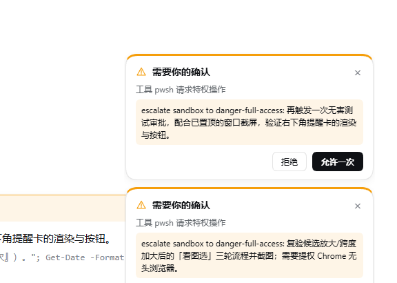
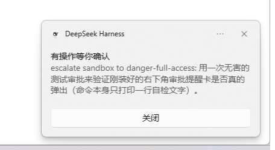

# dsh-approval-push

Approval notifier for [DeepSeek Harness](https://github.com/deepseek-ai/deepseek-harness) (`dsh`).
When a session is **waiting for permission**, this plugin shows a card in the bottom-right corner with
**Allow once / Reject**, optionally raises a desktop notification and a two-tone sound, marks the tab title,
and can push the request to your phone through **PushPlus / ServerChan / ntfy / WeCom / a custom webhook**.

Pushing is done by the host half (Node), not the browser: no keys in the page, and it keeps working while
the tab is minimized. The notification is one-way — you still answer on the machine.



## What it does

- **Corner card** — appears as soon as any session projects a pending `approval` interaction. It shows the
  tool name and the full reason (scrollable), with **Allow once** / **Reject** buttons that answer the
  request exactly like the buttons in the conversation. `×` folds the card away; the approval stays pending.
- **Desktop notification** — only while the page is in the background or unfocused, and only if the browser
  grants notification permission. Clicking it focuses Harness.
- **Sound** — two short tones per new approval, after the user has interacted with the page (browser audio
  policy); otherwise silently skipped.
- **Tab title marker** — `⚠ pending approval · …` while something waits on you.
- **Phone push** — one HTTP request per approval to the channel you configure, with de-duplication and two
  rate limits so a burst of approvals does not flood your phone.
- Only **approval** requests trigger anything. Ordinary questions (`ask_user_question`) do not.



## Install

Through the plugin market, or:

```sh
dsh plugin --profile <profile> add github:top10xiaowangzi-byte/dsh-plugins#path:/plugins/dsh-approval-push
```

After publishing to npm the same command also accepts `dsh-approval-push`. Restart the host (or reload the
profile) once; the browser half is picked up on the next page load.

Requires a `dsh` build that ships the `shell.overlay` slot and `useSessionStatus` prop. Developed and
verified on DSH Desktop `0.2.1-rc.5` (Windows). The code is cross-platform — Node built-ins plus browser
APIs only.

## Push to your phone

Configuration lives in the **host** at `%USERPROFILE%\.dsh\approval-push.push.json`
(`~/.dsh/approval-push.push.json`), created on first save. It is deliberately outside the repository and
never reaches the browser.

Minimal working config (PushPlus, WeChat):

```json
{
  "enabled": true,
  "channel": "pushplus",
  "pushplus": { "token": "your-pushplus-token", "channel": "wechat" }
}
```

| `channel` | Where it lands | Required fields |
| --- | --- | --- |
| `pushplus` | WeChat via the PushPlus service account | `pushplus.token` |
| `serverchan` | WeChat via ServerChan Turbo | `serverchan.sendKey` |
| `ntfy` | ntfy app notifications | `ntfy.topic` (+ optional `ntfy.server`) |
| `wecom` | WeCom (enterprise WeChat) group robot | `wecom.webhook` |
| `webhook` | Any HTTP endpoint you own | `webhook.url` |

Optional fields: `notifyWhen` (`always` default, or `unfocused` to push only when the Harness window is not
focused), `maxReasonChars` (default 400), `minIntervalMs` (default 3000), `maxPerMinute` (default 4).

The same settings can be written through the local route `POST /approval-push/push-config` with the header
`x-dsh-approval-push: 1`; `POST /approval-push/push-test` sends one test message with the current config.

### Local routes (loopback only)

| Method | Path | Purpose |
| --- | --- | --- |
| `POST` | `/approval-push/push` | deliver one approval notification (called by the client half) |
| `POST` | `/approval-push/push-test` | send a test message with the current config |
| `GET` | `/approval-push/push-status` | config with secrets masked + last result |
| `POST` | `/approval-push/push-config` | merge-write the config |
| `GET` | `/approval-push/push-log` | the last 40 deliveries |
| `GET` | `/approval-push/health` | client-half load self-check |

Push log: `%TEMP%\dsh-approval-push.push.log` (one line per delivery, never contains keys).

## Limitations

- The UI text of the card is Chinese in this version.
- Push is one-way: read it on the phone, answer on the computer.
- Approvals only, not ordinary questions.
- The desktop notification and sound depend on browser permissions; the card itself never does.
- The page must be open (minimized is fine). When Harness is closed there are no approvals to push.
- A failed push never affects the approval itself; it shows as one line on the card and in the log.

## Privacy

The plugin only talks to the channel you configure, only when an approval appears. Keys are read by the host
process from the config file above and are masked in every route response. There is no telemetry and no
third-party service of the author's involved.

## Development

```sh
node test/push.test.mjs     # offline unit tests: request shapes, success/failure mapping, throttling
node test/_live-check.mjs   # optional: real PushPlus/ntfy connectivity check
```

## Uninstall

Remove the plugin row from the profile (or uninstall it in the plugin manager). Optionally delete
`~/.dsh/approval-push.push.json` and `%TEMP%\dsh-approval-push.push.log`.

## License

MIT

---

# 中文说明

给 DeepSeek Harness 用的**审批提醒**插件：有会话卡在「等待审批」时，页面右下角弹出提醒卡，
可以直接点**允许一次 / 拒绝**；另可选桌面通知与提示音、标签页标题标记，并能把这条审批**推到手机**
（PushPlus / ServerChan / ntfy / 企业微信群机器人 / 自定义 webhook）。

推送由宿主半（Node）发，所以密钥不进浏览器、页面最小化也照发。手机只收到提醒，回复仍在电脑上完成。

## 功能

- **右下角提醒卡**：显示工具名与完整理由（可滚动），「允许一次 / 拒绝」等价于会话里的按钮；「×」先收起。
- **桌面通知**：页面在后台/未聚焦时发一条，点它回到 Harness；需浏览器通知权限。
- **提示音**：每来一条新审批响两声（页面交互过之后才被浏览器允许）。
- **标题标记**：有待审批时标题前加 `⚠ 待确认 ·`。
- **手机推送**：每个审批一条 HTTP，带去重与两条限流，不会刷屏。
- 只提醒**审批**，普通提问（ask_user_question）不触发。

## 安装

市场里一键安装，或者：

```sh
dsh plugin --profile <profile> add github:top10xiaowangzi-byte/dsh-plugins#path:/plugins/dsh-approval-push
```

装完重启一次宿主（或重载 profile），浏览器半刷新页面即可。

## 推送配置

配置在宿主侧 `~/.dsh/approval-push.push.json`（首次保存时创建），不进仓库、不进浏览器。
最小可用配置（PushPlus 微信推送）：

```json
{
  "enabled": true,
  "channel": "pushplus",
  "pushplus": { "token": "你的 PushPlus token", "channel": "wechat" }
}
```

渠道：`pushplus`、`serverchan`、`ntfy`、`wecom`（群机器人）、`webhook`（你自己的接口）。
可选字段：`notifyWhen`（`always` / `unfocused`）、`maxReasonChars`、`minIntervalMs`、`maxPerMinute`。

本机接口（只接受回环请求）：`/approval-push/push`、`/approval-push/push-test`、
`/approval-push/push-status`、`/approval-push/push-config`、`/approval-push/push-log`、
`/approval-push/health`。

## 已知限制

- 卡片界面文字目前是中文。
- 推送是单向的：手机上看到提醒后，仍要回到电脑点「允许一次 / 拒绝」。
- 只提醒审批，不提醒普通提问。
- 页面必须开着（最小化可以）；整个 Harness 关掉时既不会有审批也不会有推送。

## 隐私

只在你配置的渠道上、只在出现审批时发消息；密钥只在宿主进程里读取，接口返回时打码；
没有遥测，也没有作者的第三方服务参与。

## 开发

```sh
node test/push.test.mjs     # 离线单测：请求形状、成功/失败判定、节流
node test/_live-check.mjs   # 可选：真接口连通性自检（PushPlus / ntfy）
```

## 许可

MIT
